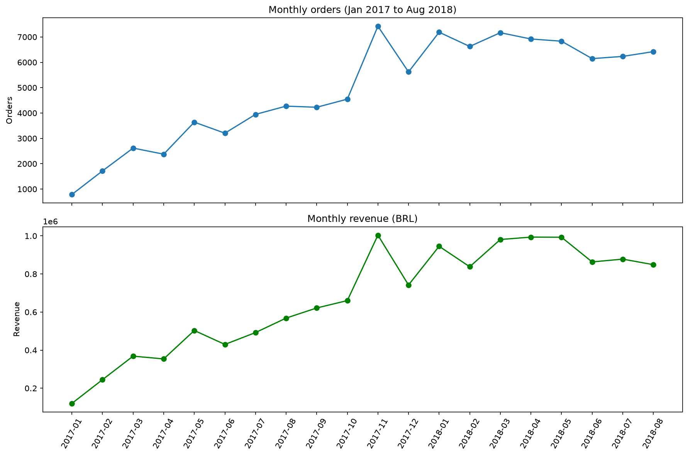
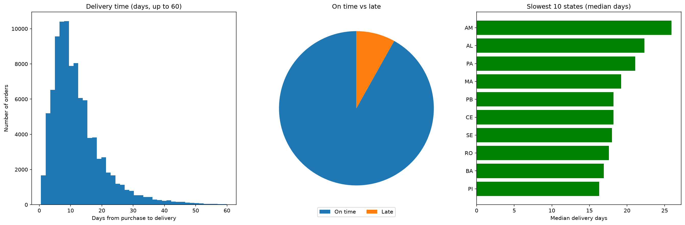
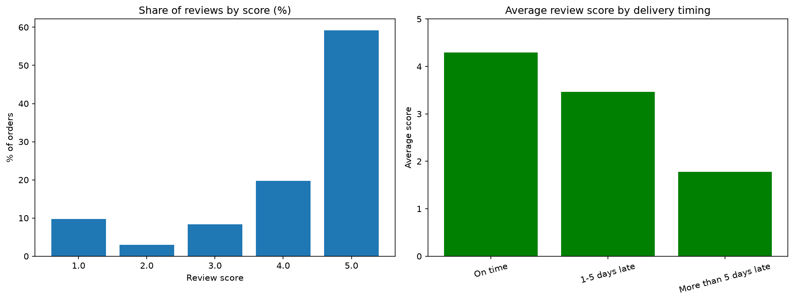
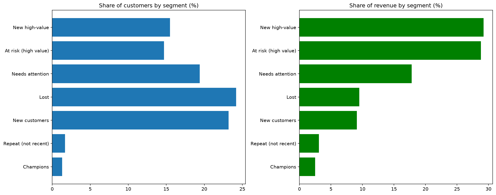
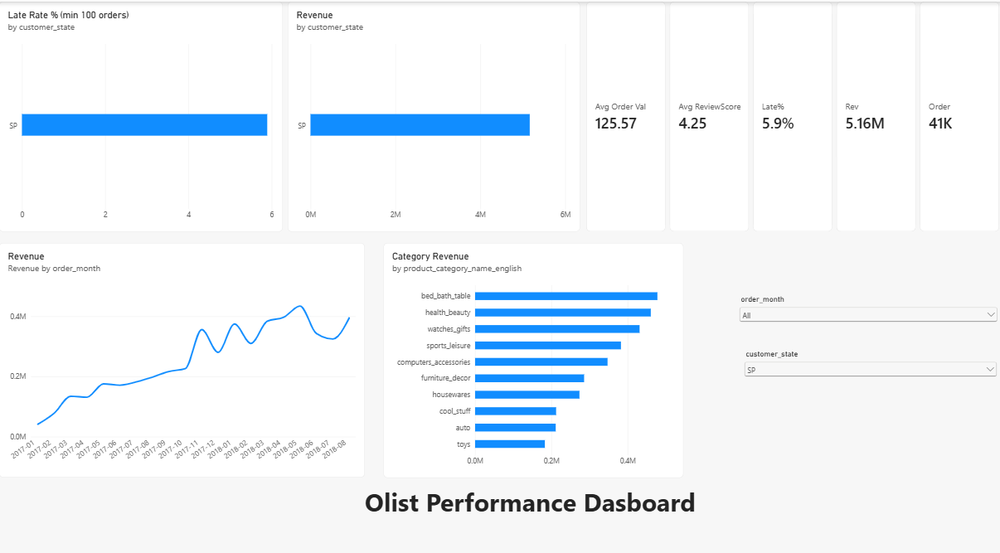

# Olist E-Commerce Performance Analysis

An end-to-end analysis of about 100,000 orders from a Brazilian online marketplace (2016 to 2018). 
The project answers one question: **where is the business gaining and losing money and customer satisfaction, and what should it do about it?**

## Business problem
The operations team needed a clear, data-based picture of sales, delivery, customer satisfaction, 
customer loyalty and seller quality, plus specific recommendations.

## Data
Brazilian E-Commerce Public Dataset by Olist (Kaggle, published by `olistbr`). 
It has 9 linked tables: orders, customers, order items, payments, reviews, products, sellers, 
geolocation and category translations. The raw files are not included here because of their size; 
download them from Kaggle to rerun the notebook.

## Tools
- **Python** (pandas, numpy, matplotlib, seaborn) in Jupyter Notebook for cleaning and analysis
- **Power BI** for the interactive dashboard
- **Excel** for the exported result tables

## Method
1. **Cleaned and joined** the 9 tables into one row per order and one row per item. Items and payments were 
   summed per order before joining to avoid double counting, and row counts were checked after every join. 
   Every cleaning decision is logged in the notebook.
2. **Exploratory analysis:** monthly trends, categories, states, payments and order value.
3. **Business questions:** delivery performance, customer satisfaction, retention (cohorts),
   RFM customer segmentation and seller performance.
4. **Recommendations**, a Power BI dashboard and a one-to-two page manager summary.

## Key findings
| Area | Finding |
|---|---|
| Sales | About 98,200 valid orders and 13.5M BRL in product sales. Orders grew about 9x from Jan 2017 to early 2018, peaked in Nov 2017 (7,423 orders, 63% above October), then levelled off. |
| Concentration | Sao Paulo state is 38.3% of sales and the top 3 states are 63.4%. The top 10 of 73 categories bring in 62.4%. |
| Order value | Mean 137 BRL, median 87 BRL (a few large orders pull the mean up). |
| Payments | Credit card is 74% of payments and boleto 19%. |
| Delivery | Median delivery 10.2 days; 8.1% of orders arrive late. Alagoas (23.9%) and Maranhao (19.7%) are worst; Rio de Janeiro has 13.5%. |
| Satisfaction | Average review 4.16. Orders more than 5 days late average 1.78 stars versus 4.29 on time, and 67% of them get 1 star. |
| Retention | Only 3.0% of customers ordered more than once. |
| Segments | High-value customers (recent and older buyers) are about 30% of customers but 58% of sales. |
| Sellers | The top 10 sellers earn only 13.2% of sales. Seller size does not predict review score (correlation -0.08); late deliveries do (-0.45). |

## Recommendations
1. Improve delivery in Rio de Janeiro, Alagoas and Maranhao and set late-delivery targets.
2. Make delivery estimates more realistic by state.
3. Prepare seller stock and carrier capacity before November.
4. Test a second-purchase offer for recent high-value customers and a win-back offer for older ones.
5. Build a seller scorecard (reviews, delivery time, late rate) and review weak high-volume sellers first.
6. Feature high-value categories such as watches and gifts.

## Selected charts

## Dashboard

## Files
## Files
- olist_analysis.ipynb and olist_analysis.html: the full analysis and cleaning log
- q1 to q10 PNG files: charts from the analysis
- olist_results.xlsx: result tables

## How to run it
1. Download the dataset from Kaggle (search "Brazilian E-Commerce Public Dataset by Olist").
2. Put the 9 CSV files in the same folder as the notebook.
3. Install the libraries: `pip install pandas numpy matplotlib seaborn openpyxl`.
4. Open `olist_analysis.ipynb` in Jupyter and choose Kernel, then Restart & Run All.

## Limitations
- Late delivery is linked to low reviews, but it is not proven to be the only cause.
- The data has only one November, so a yearly November peak is not proven.
- The customer groups (such as "at risk") are labels based on rules I defined, 
  not proof that those customers would buy again.
- Review scores belong to a whole order, so they are an imperfect measure of one seller.

## Author
[SAMA VELDA] | [https://www.linkedin.com/in/sama-velda-590300386?utm_source=share_via&utm_content=profile&utm_medium=member_ios]
